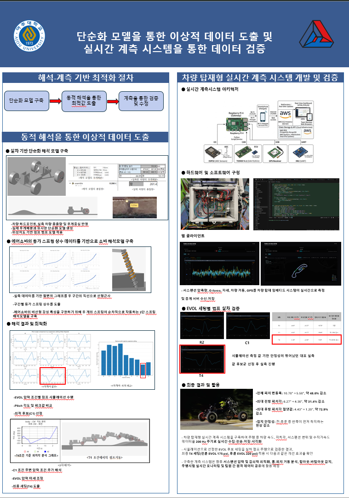
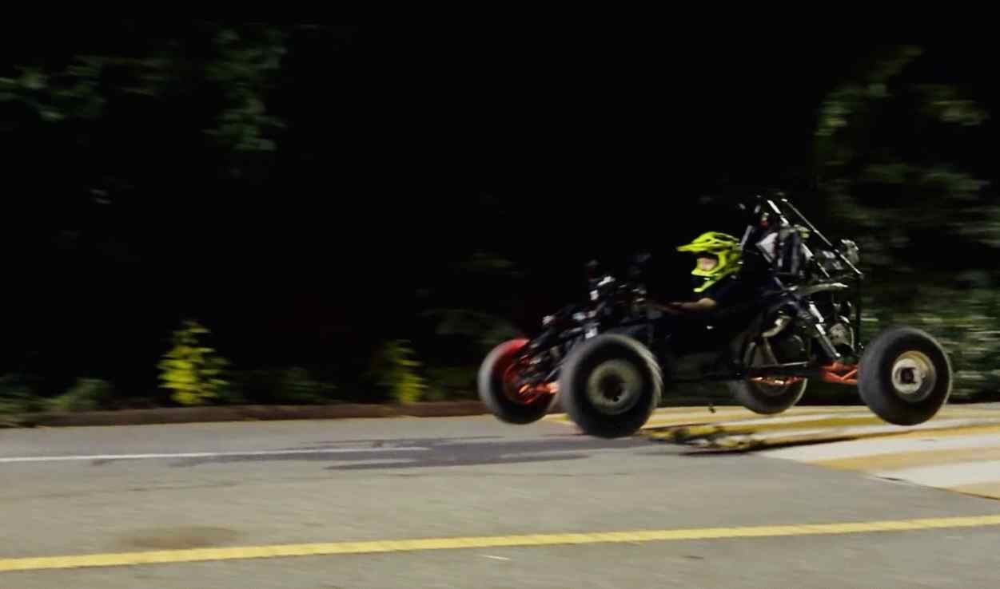
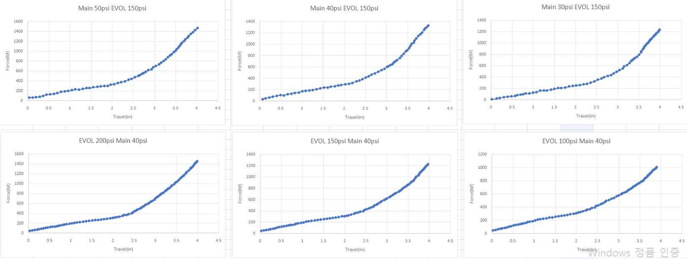
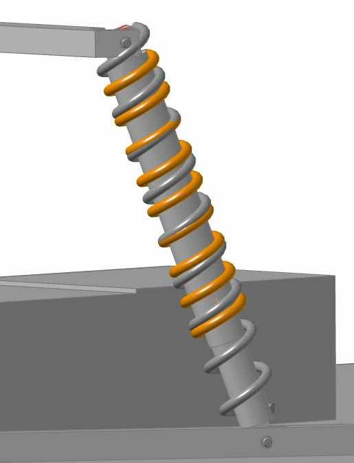
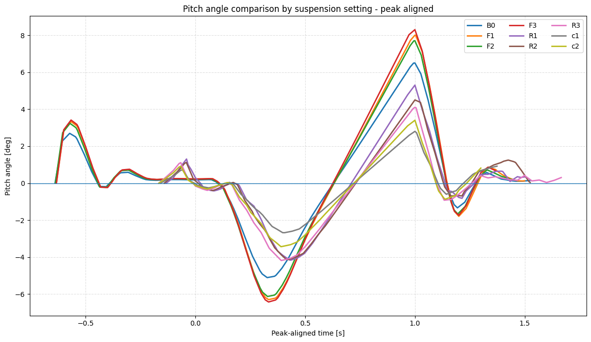
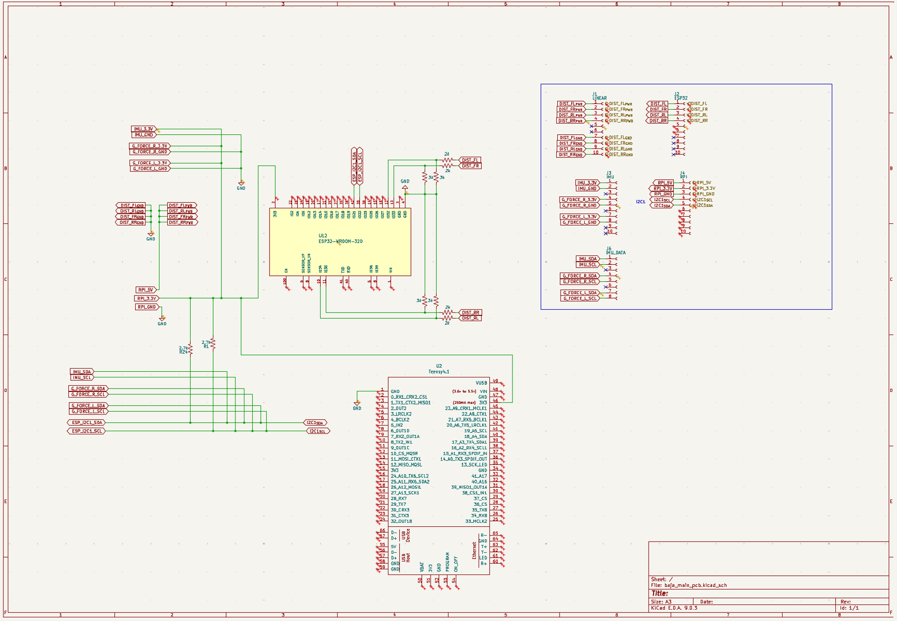
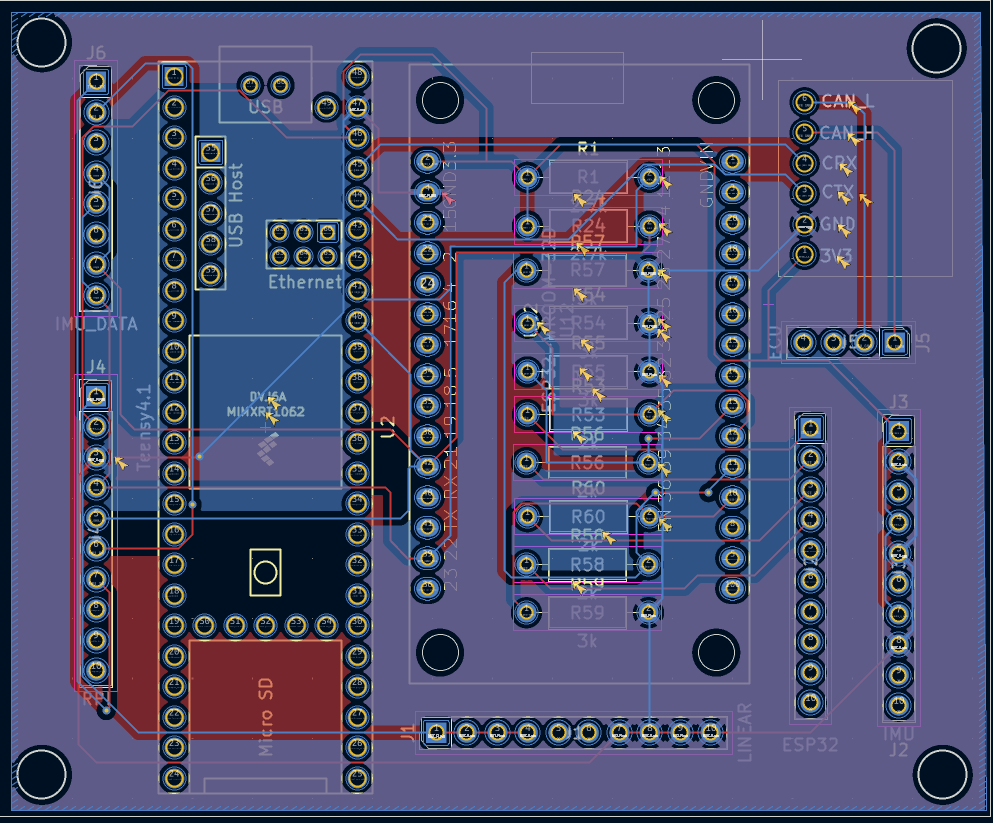
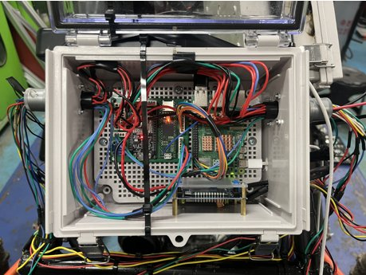
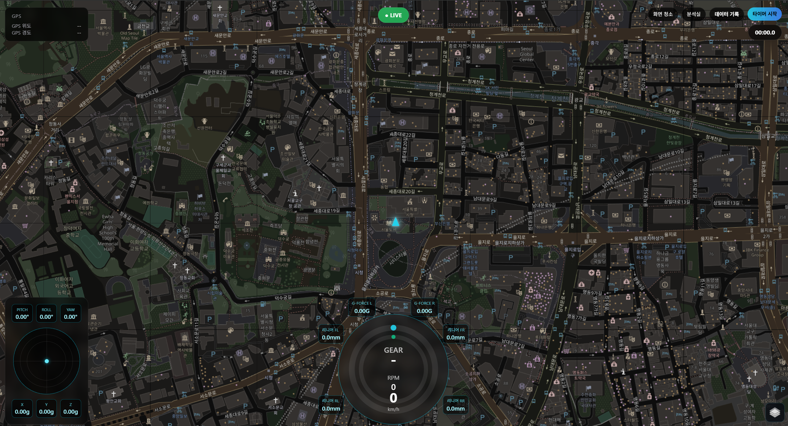

# 🏁 A-FA BAJA: 해석 기반 서스펜션 최적화 & 차량 탑재형 실시간 계측 시스템

> **아주대학교 자작자동차 동아리 A-FA** · 2026 KSAE 대학생 자작자동차대회 기술부문 (기술아이디어)
>
> 단순화 모델로 이상적인 서스펜션 세팅을 찾고, **직접 만든 실시간 계측 시스템**으로 실차에서 검증했습니다.
> 에어쇼바 진동 해석부터 PCB 설계, 계측 박스 패키징, MCU 펌웨어, 텔레메트리 서버와 웹 대시보드까지 **해석 → 하드웨어 → 소프트웨어 → 실차 검증** 전 과정을 맡았습니다.



---

## 📌 핵심 성과

| 지표 | 기존 (R2) | 최종 (T4) | 개선 |
|---|---|---|---|
| 전체 피치 변동폭 | 10.70° | **5.50°** | **▼ 48.6%** |
| 최대 전방 피치각 | 6.27° | **4.30°** | **▼ 31.4%** |
| 최대 후방 피치각 | 4.43° | **1.20°** | **▼ 72.9%** |

- 시뮬레이션 1차 최적 후보(C1)에서 최대 전방 피치각을 기준 대비 **56.9%** 줄였습니다.
- 최종 T4 세팅에서는 점프 착지 때 전·후륜이 거의 동시에 닿는 **수평 착지**를 확인했습니다.
- 계측 시스템이 차량 속도, 피치각, 서스펜션 변위, 수직 가속도를 실시간으로 수집·전송·저장·시각화합니다.

<p align="center">
  
</p>

---

## 🧭 전체 흐름

```
 ① 해석                     ② 하드웨어 & MCU               ③ 서버                      ④ 검증
 에어쇼바 힘-변위 실측        센서 선정 · 회로 설계           MQTT 수집 · 정규화           실차 점프 시험
 등가 강성식 도출       →     KiCad PCB 제작          →     InfluxDB 저장          →     세팅별 피치 비교
 Altair 점프 시뮬레이션       방진·방수 패키징                WebSocket 실시간 HUD         최종 세팅(T4) 확정
 후보 세팅 선정              RPi · ESP32 · Teensy 펌웨어     분석실 그래프 비교
```

---

## 🗂️ 레포 구성

이 레포는 **서버**와 **하드웨어 & MCU** 두 갈래로 나뉩니다.

| 디렉터리 | 내용 | 문서 |
|---|---|---|
| [`server/`](server/) | FastAPI 백엔드, React 대시보드, Mosquitto, 배포 설정 | [server/README.md](server/README.md) |
| [`hardware/`](hardware/) | 라즈베리파이(메인 MCU), 센서별 코드, PCB | [hardware/README.md](hardware/README.md) |
| [`docs/`](docs/) | 서스펜션 해석 문서, 이미지 | [docs/suspension-analysis.md](docs/suspension-analysis.md) |

```
A-FA-BAJA/
├── server/                  # 실시간 텔레메트리 서버 & 웹 대시보드
│   ├── app/backend/         #   FastAPI · MQTT 수집 · InfluxDB · WebSocket
│   ├── app/frontend/        #   React LIVE 대시보드 · 분석실
│   ├── mosquitto/           #   MQTT 브로커 설정
│   └── deploy/              #   systemd 서비스
├── hardware/                # 차량 탑재형 계측 하드웨어 & MCU
│   ├── raspberry-pi/        #   메인 MCU (센서 통합 · MQTT 송신)
│   ├── sensors/             #   센서별 펌웨어 (ESP32 · IMU · GPS · CAN ...)
│   └── pcb/                 #   KiCad 설계 파일
└── docs/                    # 서스펜션 해석 문서 & 이미지
```

---

## 🙋 담당 역할

| 분야 | 한 일 |
|---|---|
| **🛞 서스펜션 해석** | 에어쇼바 힘-변위 실험, 구간별 등가 스프링 상수식 도출, 2단 병렬 스프링 쇼바 모델링, Altair Inspire 점프 착지 동역학 해석 (EVOL 압력 9조건 + 미세 조정) |
| **🔌 회로 & PCB** | 센서·MCU 통합 회로 설계, ADC 분압·I2C 풀업 설계, KiCad PCB 아트웍 및 제작 |
| **📦 패키징** | 방수 케이스 기반 계측 박스 구성, 방진 고정·배선 정리, 4륜 리니어 센서 차량 장착 |
| **🧠 MCU / 임베디드** | 라즈베리파이 센서 통합·MQTT 송신, ESP32 ADC 수집·I2C 전달, Teensy CAN 통신 |
| **🖥️ 서버 & 웹** | AWS EC2 인프라, FastAPI 수집 파이프라인, InfluxDB 비동기 저장, WebSocket 실시간 HUD, 분석실 |
| **🏁 실차 검증** | 후보 세팅(R2·C1·T4) 실차 점프 시험, 계측 데이터 기반 피치 거동 비교, 최종 세팅 확정 |

---

## 1️⃣ 서스펜션 해석: 에어쇼바 등가 강성 & 점프 착지 최적화

| 압력별 힘-변위 실측 | 2단 스프링 쇼바 모델 | 세팅별 피치각 비교 |
|---|---|---|
|  |  |  |

- 에어쇼바의 MAIN/EVOL 챔버 압력을 따로 바꿔가며 힘-변위를 측정하고, **2.5 in 기준으로 구간을 나눈 등가 강성식**을 만들었습니다.

  $$K_{eq} = \big[1-H(x-2.5)\big]\,(16075.47 + 192.42P_{MAIN}) + H(x-2.5)(28785.01 + 392.64P_{MAIN} + 476.55P_{EVOL})\ [\mathrm{N/m}]$$

- 실차 무게배분(44.95 : 55.11)과 질량(266 kg)을 반영한 단순화 모델로 60 km/h 범프 점프를 시뮬레이션했습니다.
- **"앞쪽만 단단하게"는 오히려 피치를 키우고, 후륜 강성비를 높여야 착지가 안정된다**는 인사이트를 얻어 최종 **T4 (전 EVOL 175 psi / 후 EVOL 220 psi)** 를 도출했습니다.

👉 **자세히 보기: [docs/suspension-analysis.md](docs/suspension-analysis.md)**

---

## 2️⃣ 하드웨어 & MCU: 차량 탑재형 계측 시스템

| 회로도 | PCB | 계측 박스 |
|---|---|---|
|  |  |  |

- **Raspberry Pi 4**(메인)가 GPS(USB), IMU(UART), 가속도(I2C), **ESP32**(4륜 리니어 센서 ADC → I2C), **Teensy 4.1**(ECU CAN) 데이터를 통합해 MQTT로 송신합니다.
- 진동이 심한 오프로드 환경에서 접촉 불량을 없애려고 **센서·전원·통신 배선을 하나로 통합한 PCB**를 KiCad로 설계·제작했습니다.
- 5 V 리니어 센서 출력은 2k/3k 분압으로 ESP32 ADC 범위에 맞추고, I2C 버스에는 2.7 kΩ 풀업을 달았습니다.

👉 **자세히 보기: [hardware/README.md](hardware/README.md)**

---

## 3️⃣ 서버: 실시간 텔레메트리 & 분석 대시보드



- **MQTT → FastAPI → InfluxDB / WebSocket** 파이프라인으로 차량 데이터를 실시간 수집·저장·시각화합니다.
- 저장 경로와 실시간 전송 경로를 분리해 DB가 지연돼도 HUD가 멈추지 않게 하고, 순번·타임스탬프로 중복·역순 패킷을 제거합니다.
- 분석실에서 세팅별 주행 기록을 같은 시간축에 겹쳐 비교하며, 이 기능으로 R2·C1·T4의 실차 피치 거동을 비교했습니다.

👉 **자세히 보기: [server/README.md](server/README.md)**

---

## 🛠️ 기술 스택

| 영역 | 기술 |
|---|---|
| **해석** | Altair Inspire (Motion), Python (Matplotlib), Excel |
| **회로 / PCB** | KiCad 9 |
| **임베디드** | Raspberry Pi 4, ESP32, Teensy 4.1, I2C · UART · CAN · USB |
| **Backend** | Python, FastAPI, paho-mqtt, asyncio, InfluxDB 2, Mosquitto |
| **Frontend** | React 18, Vite, Tailwind CSS, Leaflet, Recharts |
| **Infra** | AWS EC2 (Ubuntu), systemd |

---

## 🚗 차량 제원 (A-FA 125)

| 항목 | 값 |
|---|---|
| 크기 | 2147 × 1530 × 1391 mm (L × W × H) |
| 무게 | 220 kg |
| 서스펜션 | 에어쇼바 (MAIN / EVOL 2챔버) |
