# 🛞 에어쇼바 등가 강성 모델링 & 점프 착지 서스펜션 최적화

> **해석으로 후보를 좁히고, 계측으로 최종값을 확정한다.**
> 에어쇼바 힘-변위 실측 → 구간별 등가 스프링 상수식 도출 → 다물체 동역학 점프 시뮬레이션 → 직접 만든 계측 시스템으로 실차 검증까지 이어지는 서스펜션 세팅 절차를 만들었습니다.

[← 메인 README로](../README.md)

---

## 1. 문제 정의

<p align="center">
  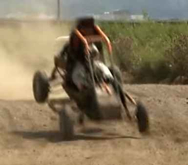
</p>

- 2025 Baja 대회에서 다수 차량이 점프 후 **전륜이 먼저 지면에 닿는 현상**을 확인했습니다. 전륜 선착지는 착지 충격을 키우고 피치 운동을 유발해, 착지 직후 이어지는 코너 구간의 조종 안정성까지 떨어뜨립니다.
- 랠리·고성능 오프로드 차량처럼 **네 바퀴가 최대한 동시에 착지**하는 거동을 목표로 잡았습니다.
- 기존에는 에어쇼바 압력을 드라이버 체감과 반복 주행으로 정했습니다. 시간이 많이 들고, 비슷한 체감의 세팅끼리는 정량 비교가 어렵다는 한계가 있었습니다.

**목표**: 시뮬레이션으로 세팅 범위를 좁히고, 실차 계측으로 최종 세팅을 확정하는 **정량적 세팅 절차** 구축

---

## 2. 실차 기반 단순화 해석 모델

| 단순화 모델 | 점프 시뮬레이션용 범프 & 차량 |
|---|---|
| 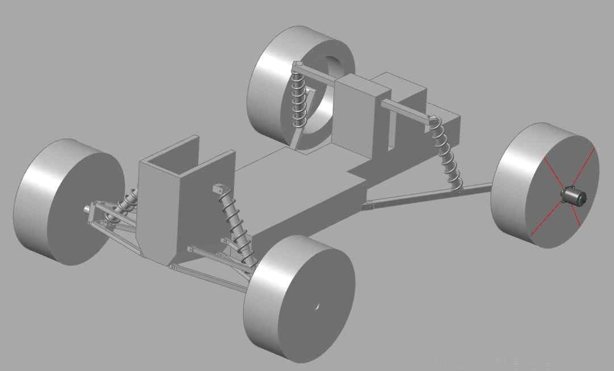 | 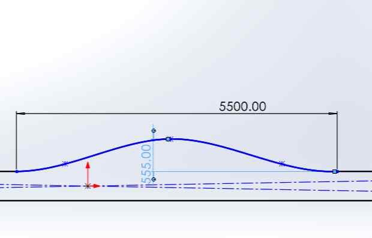 |

- 실차 하드포인트와 무게배분을 반영한 차량 모델을 **Altair Inspire**에서 구성하고, 각 휠을 스프링·댐퍼 요소로 연결했습니다.
- 해석 모델과 실차의 질량 특성을 맞춰 모델 신뢰도를 확보했습니다.

| 항목 | 해석 모델 | 실차 측정값 |
|---|---|---|
| 총 질량 | 266 kg | 261.4 kg |
| 전·후 무게배분 | 44.95 : 55.11 (질량중심: 전륜축 기준 972.59 mm) | 44.5 : 55.5 |
| 무게중심 높이 | 552 mm | 552 mm |

- **범프 형상**: 군산 서킷에서 차량이 가장 빠르게 진입해 점프가 가장 크게 나오는 직선 끝 범프를 대상으로, 위성지도 기반 길이(5.5 m)와 고도(약 0.55 m)를 추정해 모델링했습니다. 진입 속도는 실제 주행 데이터를 바탕으로 **60 km/h**로 설정했습니다.
- **접촉 조건**: 타이어-노면 정지 마찰계수 0.8, 동마찰계수 0.6, 접촉 강성 500 N/mm, 접촉 감쇠 2.0 N·s/mm, 침투 깊이 0.1 mm. 비현실적 침투와 수치 불안정 사이에서 수렴성이 확보되는 범위로 선정했습니다.

---

## 3. 에어쇼바 등가 스프링 상수 도출

에어쇼바는 압축량에 따라 MAIN 챔버와 EVOL 챔버의 영향이 달라지는 **비선형 스프링**입니다. 이를 해석 모델에 넣기 위해 실측 기반의 구간별 등가 강성식을 만들었습니다.

### 3-1. 힘-변위 실측

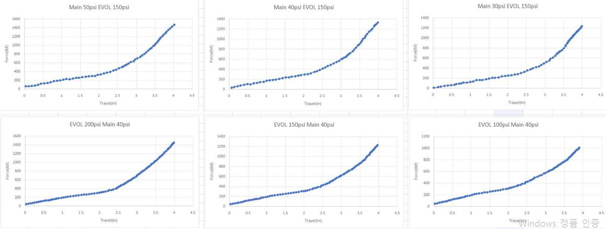

- 외부 하중이 없는 완전 신장 상태를 기준으로 쇼바 축방향으로 최대 약 4 in까지 압축하며 반력을 측정했습니다.
- 두 챔버의 영향을 분리하기 위해 **EVOL 150 psi 고정 + MAIN 30/40/50 psi**, **MAIN 40 psi 고정 + EVOL 100/150/200 psi** 조건으로 나눠 실험했습니다.

### 3-2. 압축 구간 분리 (2.5 in 기준)

| 구간 | 지배 챔버 | 대응 상황 |
|---|---|---|
| 0 ~ 2.5 in | MAIN | 일반 노면 주행의 작은 변위 |
| 2.5 in 초과 | MAIN + EVOL | 큰 요철·점프 착지 (바텀아웃 방어) |

각 구간을 `F = kx + b`로 근사해 평균 기울기를 구하고, 챔버 압력에 대해 선형 피팅했습니다.

| EVOL | MAIN | 0~2.5 in 평균 기울기 | 2.5 in 초과 평균 기울기 |
|---|---|---|---|
| 150 psi | 30 psi | 124.558 lbf/in | 644.838 lbf/in |
| 150 psi | 40 psi | 136.140 lbf/in | 652.166 lbf/in |
| 150 psi | 50 psi | 146.533 lbf/in | 689.679 lbf/in |
| 100 psi | 40 psi | – | 411.682 lbf/in |
| 200 psi | 40 psi | – | 683.801 lbf/in |

### 3-3. 최종 등가 강성식

$$K_{pre} = 16075.47 + 192.42\,P_{MAIN}\ \ [\mathrm{N/m}]$$

$$K_{post} = 28785.01 + 392.64\,P_{MAIN} + 476.55\,P_{EVOL}\ \ [\mathrm{N/m}]$$

$$K_{eq} = \big[1 - H(x-2.5)\big]\,K_{pre} + H(x-2.5)\,K_{post}$$

- `H`는 단위 계단 함수(스위치 함수)로, 압축량 2.5 in 전에는 초기 강성식, 이후에는 후반 강성식이 적용됩니다.
- 초기 구간에서는 EVOL 압력에 따른 곡선 차이가 작아 EVOL 항을 넣지 않았습니다.

### 3-4. 가변 강성 쇼바 모델 (2단 병렬 스프링)

<p align="center">
  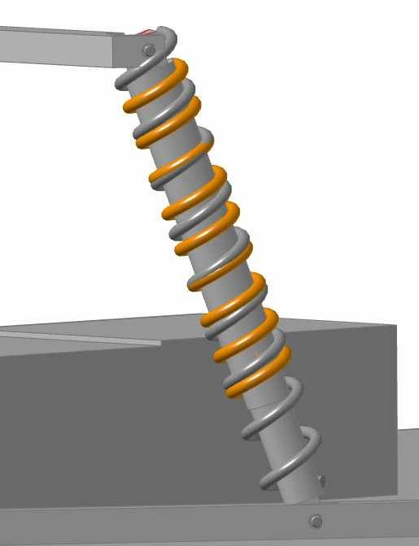
</p>

- 단일 선형 스프링으로는 구간별 강성 변화를 표현할 수 없어서, **두 개의 코일 스프링을 병렬로 배치**했습니다.
- 보조 스프링을 기본 스프링보다 2.5 in 짧게 설정해, 2.5 in 이후부터 두 스프링이 함께 압축되며 강성이 합산되도록 했습니다.
- 이 구조로 MAIN 압력(초기 승차감)과 EVOL 압력(바텀아웃 방어)의 영향을 독립적으로 반영할 수 있습니다.

---

## 4. 동역학 해석 & 세팅 최적화

### 4-1. 1차 해석: EVOL 압력 스윕

MAIN 압력은 전 50 psi / 후 75 psi로 고정하고, 점프 착지 거동에 직접 영향을 주는 **EVOL 압력**을 변수로 잡았습니다. 기준 조건 B0는 후륜 축하중이 약 22.6% 더 크다는 점을 반영해 후륜 강성을 약 20% 높게 둔 중립 조건입니다.

| 해석 | 목적 | 전 EVOL | 후 EVOL | 전 후반강성 | 후 후반강성 |
|---|---|---|---|---|---|
| B0 | 기준 | 150 | 180 | 119.9 kN/m | 144.0 kN/m |
| F1 / F2 / F3 | 앞쪽 소프트 / 하드1 / 하드2 | 120 / 180 / 210 | 180 | 105.6 / 134.2 / 148.5 | 144.0 |
| R1 / R2 / R3 | 뒤쪽 소프트 / 하드1 / 하드2 | 150 | 150 / 210 / 240 | 119.9 | 129.7 / 158.3 / 172.6 |
| C1 / C2 | 앞뒤 동시 상승 1 / 2 | 180 / 210 | 210 / 240 | 134.2 / 148.5 | 158.3 / 172.6 |

| 피치각 비교 (Peak aligned) | 세팅별 최대 피치각 |
|---|---|
| 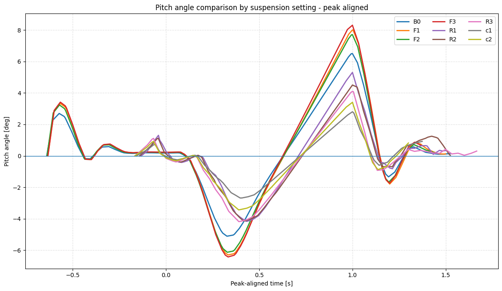 | 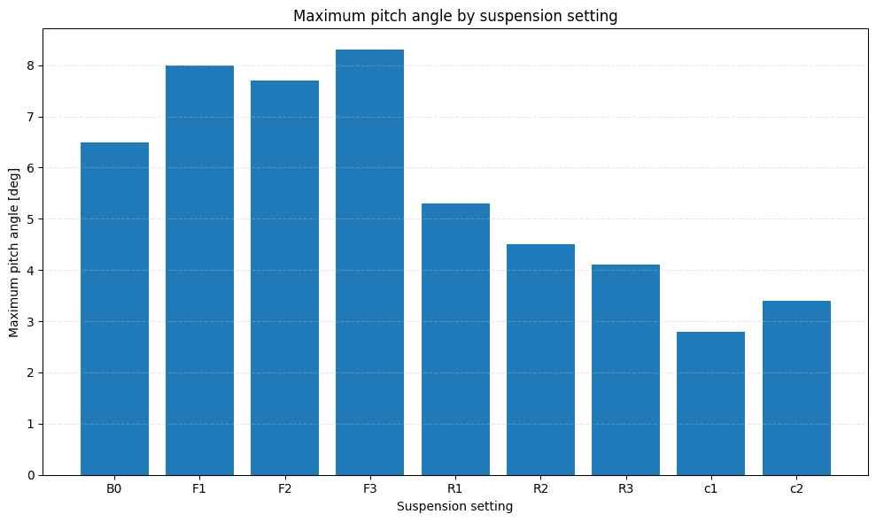 |

**해석 결과에서 얻은 인사이트**

- 앞쪽만 바꾼 F1~F3은 소프트/하드 모두 B0보다 **오히려 전방 피치가 증가**(약 8.0°~8.3°)했습니다. 앞쪽 강성만 조절해서는 안정적인 착지를 얻을 수 없습니다.
- 뒤쪽 강성을 높일수록(R1→R3) 최대 전방 피치가 감소했습니다. 후륜 하중 비중이 큰 차량에서는 **후륜 후반부 강성 확보가 핵심**입니다.
- **C1**에서 최대 전방 피치각 **2.8°**로 B0(6.5°) 대비 **56.9% 감소**, peak-to-peak 피치도 약 53% 감소해 1차 최적 후보로 선정했습니다.
- 더 단단한 C2는 오히려 3.4°로 다시 증가했습니다. 무조건 강성을 높이기보다 **앞뒤 강성비**를 맞추는 것이 효과적이라는 결론을 얻었습니다.

### 4-2. 2차 해석: C1 주변 미세 조정 → T4 도출

| T4 피치각 해석 | T4 점프 거동 |
|---|---|
| 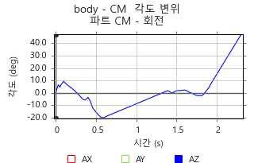 | 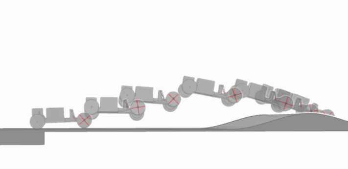 |

- 앞쪽 EVOL은 소폭 낮춰 과도한 전륜 반발 억제(180 → **175 psi**), 뒤쪽 EVOL은 높여 후륜 하중 지지 강화(210 → **220 psi**)
- 앞뒤 강성 합계는 0.8%만 늘었지만 **후/전 강성비는 약 4.9% 증가**했습니다. 단순 고강성 세팅이 아니라 착지 시 전후 하중 지지 균형을 개선한 세팅입니다.
- 착지 이후 피치각이 0° 부근으로 빠르게 회복하며 변동폭이 작게 유지됐습니다.

---

## 5. 실차 점프 시험 & 계측 기반 검증

시뮬레이션으로 고른 후보 **R2(뒤쪽 강성 영향 확인) / C1(1차 최적) / T4(최종 후보)** 를 실차에 적용하고, 직접 만든 [계측 시스템](../hardware/README.md)으로 착지 전후 피치각을 서버에 실시간 전송·기록해 비교했습니다. (주황: 속도 km/h, 파랑: Pitch)

| R2 | C1 |
|---|---|
| 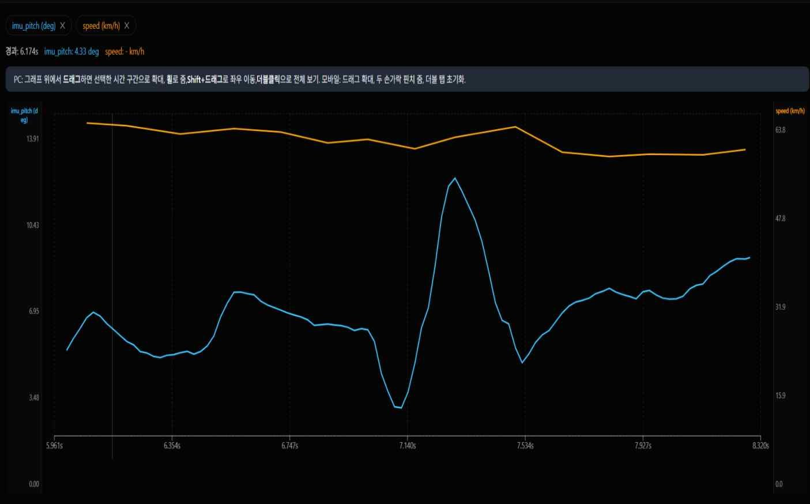 | 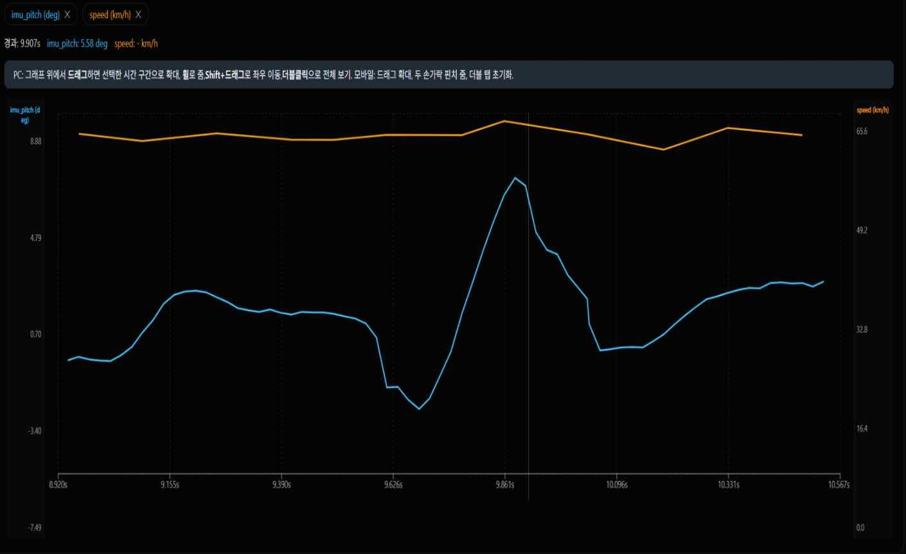 |

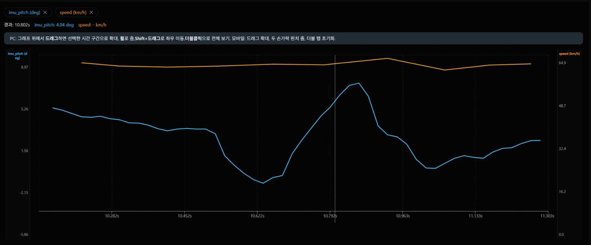

| 비교 항목 | R2 | C1 | **T4** | T4 개선율 (R2 대비) |
|---|---|---|---|---|
| 최대 전방 피치각 | +6.27° | +6.17° | **+4.30°** | **31.4% 감소** |
| 최대 후방 피치각 | −4.43° | −4.32° | **−1.20°** | **72.9% 감소** |
| 전체 피치 변동폭 | 10.70° | 10.49° | **5.50°** | **48.6% 감소** |

<p align="center">
  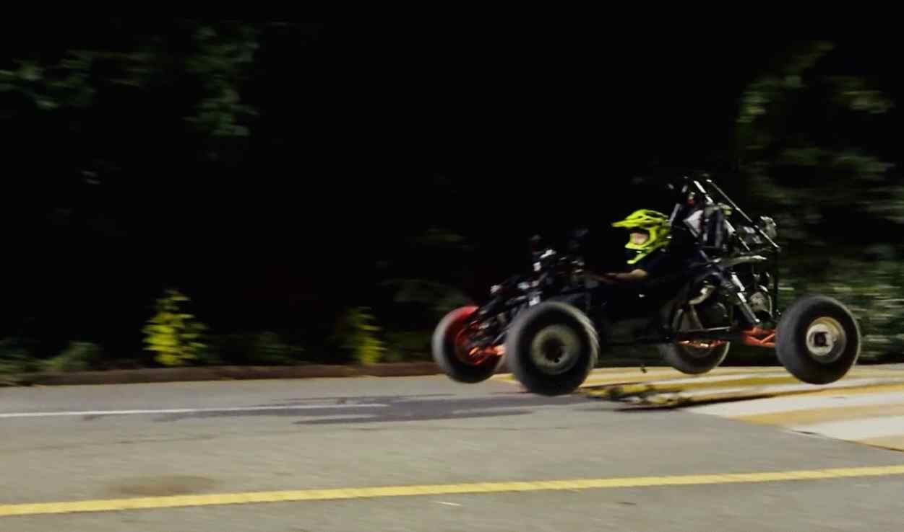
  <br><sub>T4 세팅에서 수평에 가까운 자세로 착지 직전인 차량</sub>
</p>

### 시뮬레이션과 실차의 차이에 대한 해석

- 수치가 완전히 일치하지는 않았습니다. 실차에는 타이어 변형, 쇼바 감쇠력, 범프 진입 속도, 점프대 형상, 운전자 탑승 위치, 노면 상태가 추가로 작용하기 때문입니다.
- 하지만 **"후륜 강성을 상대적으로 높이는 방향이 유효하다"는 경향은 실차에서도 동일**하게 나타났습니다.
- 이 절차는 실차 시험을 대체하는 것이 아니라, **세팅 범위를 효율적으로 좁혀 시험 횟수를 줄이는 데** 의미가 있습니다.

---

## 6. 정리

```
힘-변위 실험  →  구간별 등가 강성식  →  2단 스프링 쇼바 모델  →  EVOL 압력 스윕(9조건)
     →  C1 선정  →  미세 조정(T4)  →  실차 점프 시험 + 자체 계측 시스템 검증
```

- 경험·체감에 의존하던 세팅을 **실험 → 모델링 → 시뮬레이션 → 계측**으로 연결된 정량적 절차로 바꿨습니다.
- 최종 **T4 세팅(전 EVOL 175 psi / 후 EVOL 220 psi)** 으로 실차 전체 피치 변동폭을 **48.6%** 줄였습니다.
- 같은 계측 인프라로 롤 거동 분석, 감쇠력 최적화, 주행 상황별 통합 세팅 연구로 확장할 수 있습니다.

**사용 도구**: Altair Inspire (Motion), Python (Matplotlib, 피치각 후처리·시각화), Excel (힘-변위 피팅), 자체 텔레메트리 시스템 (실측)
