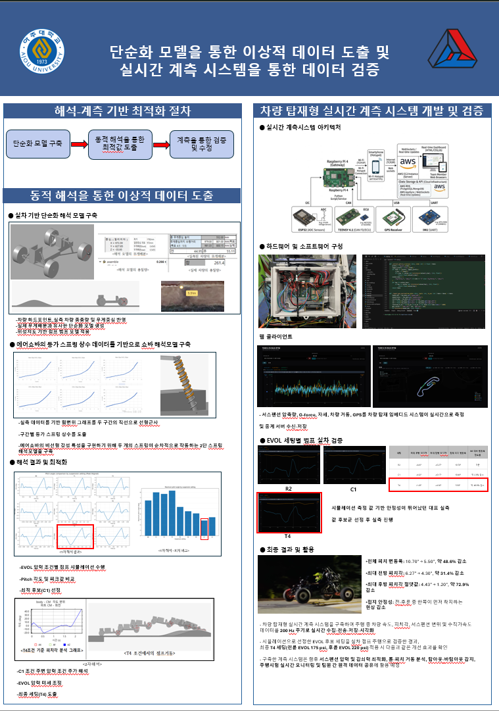
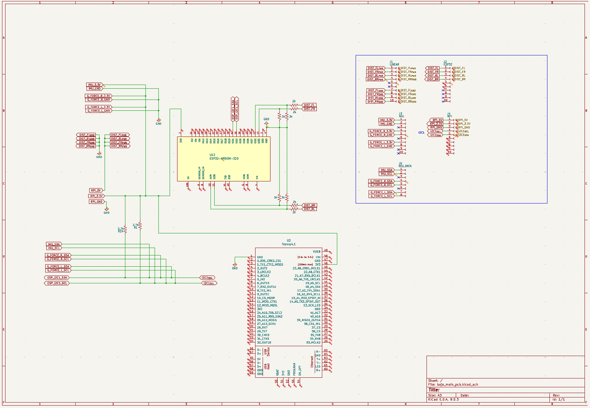
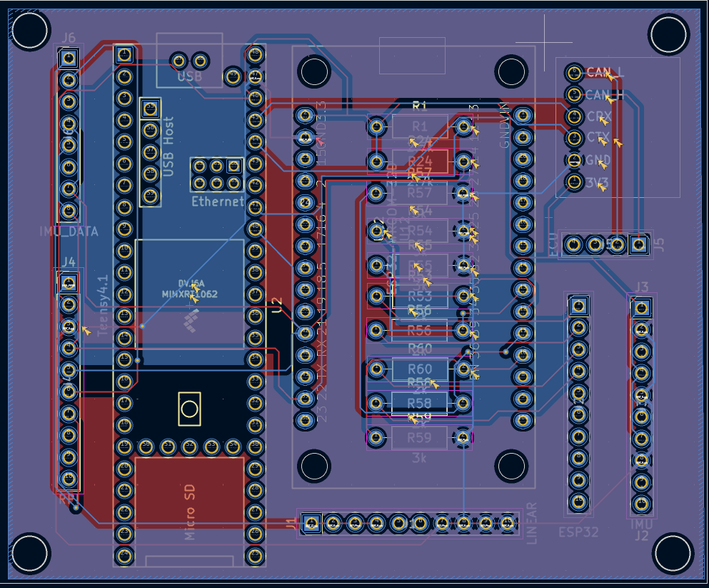
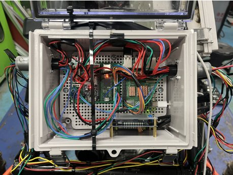
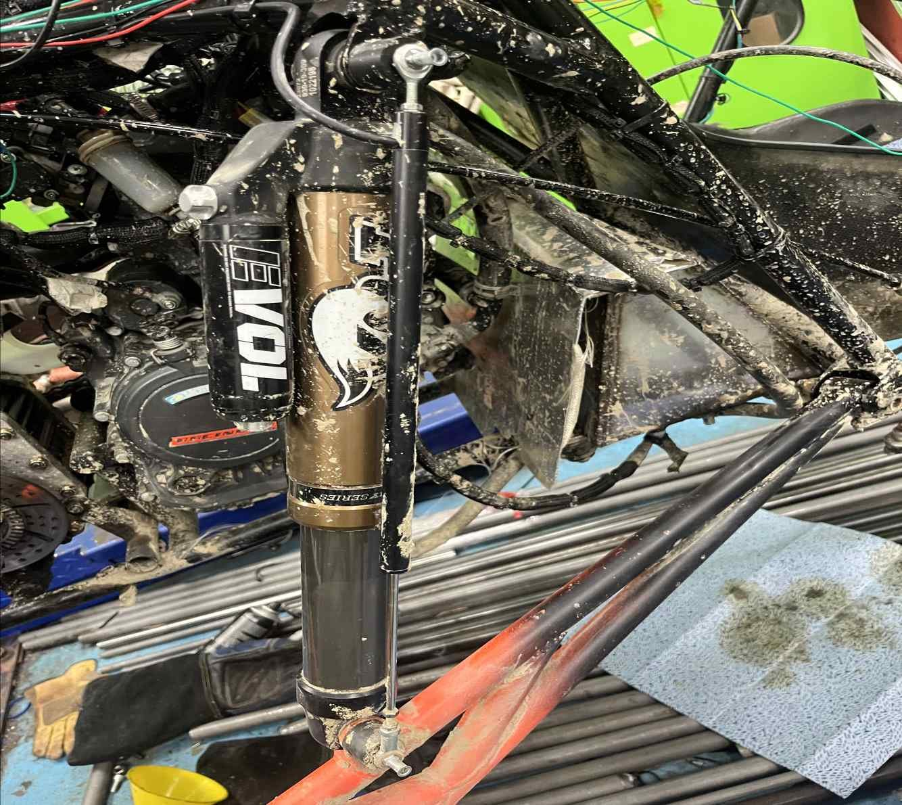

# 🔧 Hardware & MCU — 차량 탑재형 계측 시스템

서스펜션 세팅을 정량적으로 비교하기 위해 만든 **차량 탑재형 계측 시스템**입니다.
센서 선정, 회로 설계와 PCB 제작, 방진·방수 패키징, MCU 펌웨어까지 직접 진행했습니다.
수집한 데이터는 MQTT로 [서버](../server/README.md)에 보내고, [점프 착지 서스펜션 최적화](../docs/suspension-analysis.md)의 실차 검증에 썼습니다.

[← 메인 README로](../README.md) · [서버 →](../server/README.md)

---

## 1. 왜 만들었나

- 기존 세팅은 쇼바 압력을 바꾼 뒤 **드라이버 체감**으로 판단했습니다. 비슷한 체감의 세팅끼리 구분하기 어렵고, 점프 착지처럼 짧은 순간에 일어나는 거동은 판단 자체가 어렵습니다.
- 시뮬레이션으로 고른 후보 세팅을 **실차 데이터로 검증**하려면, 주행 중 차체 자세와 4륜 서스펜션 변위를 직접 측정할 장비가 필요했습니다.

---

## 2. 시스템 구성



```
 [리니어 변위센서 ×4] ─ 아날로그 ─▶ [ESP32]  ── I2C ──┐
 [보조 가속도(G-Force) L/R] ──────────── I2C ─────────┤
 [메인 IMU] ───────────────────────────── UART ───────┤
 [GPS] ─────────────────────────────────── USB ───────┼─▶ [Raspberry Pi 4] ── MQTT (Wi-Fi/LTE) ──▶ 서버
 [ECU] ── CAN ─▶ [Teensy 4.1] ─────────────────────────┘
```

| 센서 / 장치 | 통신 | 설치 위치 | 주요 측정값 | 분석 목적 |
|---|---|---|---|---|
| 리니어 변위센서 ×4 | ESP32 ADC → I2C | 각 쇼바 옆 | 전·후륜 좌·우 쇼바 변위 | 휠별 작동 변위, 탑아웃·바텀아웃 판단 |
| 메인 IMU | UART | 차량 무게중심 근처 | 롤·피치·요, 3축 가속도 | 코너링·점프 시 차체 자세 |
| 보조 가속도 센서 | I2C | 차량 프론트 | Z축 가속도, 수직 G | 언덕·요철 통과 시 전륜부 수직 충격 |
| GPS | USB | 수신이 잘 되는 차량 상부 | 위치, 속도 | 속도 구간별 거동 비교, 랩 분석 |
| Teensy 4.1 | CAN | 메인 PCB | ECU 데이터 (RPM·기어 등) | 파워트레인 상태 모니터링 |

### 역할 분리
- **Raspberry Pi (메인 MCU)**: 센서 데이터를 통합해 표준 JSON 패킷으로 만들고 MQTT로 송신하는 데만 집중합니다. 저장·정렬·분석은 서버가 맡아서, 차량 쪽 부하를 줄이고 서버만 고쳐도 기능을 확장할 수 있게 했습니다.
- **ESP32 (보조 MCU)**: 라즈베리파이에는 ADC가 없어서, 4륜 리니어 센서의 아날로그 신호를 ESP32가 ADC로 읽고 하나의 데이터 구조로 묶어 I2C로 넘깁니다. 센서를 추가하거나 배선을 바꿔도 ESP32 입력 채널만 고치면 됩니다.
- **Teensy 4.1**: ECU와 CAN 통신을 담당합니다.

### 수집 · 송신 주기
- 리니어 변위, IMU, 보조 가속도처럼 빠른 거동을 봐야 하는 데이터는 **20 ms (50 Hz)** 간격으로 송신합니다.
- GPS처럼 갱신 주기가 느린 데이터는 수신기에서 새 값이 들어올 때만 송신합니다.
- 모든 패킷에 단조 증가 순번(`seq`)과 생성 시각(`ts_ms`)을 넣어, 통신 지연이나 재접속이 생겨도 서버가 중복·과거 데이터를 걸러낼 수 있게 했습니다.

| 데이터 키 | 의미 | 단위 |
|---|---|---|
| `linear_fl` | 전륜 좌측 쇼바 변위 | mm |
| `linear_fr` | 전륜 우측 쇼바 변위 | mm |
| `linear_rl` | 후륜 좌측 쇼바 변위 | mm |
| `linear_rr` | 후륜 우측 쇼바 변위 | mm |

---

## 3. 회로 설계 & PCB 제작 (KiCad)

Baja 차량은 비포장 노면과 점프 착지에서 계속 충격과 진동을 받습니다. 브레드보드나 점퍼선 같은 임시 배선으로는 **접촉 불량과 데이터 누락**이 생길 수 있어서, 센서 연결부·전원·통신 배선을 **하나의 기판으로 통합한 PCB**를 설계·제작했습니다. 덕분에 반복 시험에서도 같은 조건으로 데이터를 모을 수 있었습니다.

| 회로도 | PCB 레이아웃 |
|---|---|
|  |  |

**설계 포인트**
- **MCU 통합 보드**: Teensy 4.1과 ESP32-WROOM-32D를 한 기판에 올리고, CAN 트랜시버 모듈(CAN_H/CAN_L, CTX/CRX) 헤더를 배치했습니다.
- **ADC 입력 레벨 변환**: 5 V로 구동되는 리니어 변위센서 출력을 **2 kΩ / 3 kΩ 분압**으로 최대 3.0 V로 낮춰 ESP32 ADC(3.3 V) 입력 범위에 맞췄습니다.
- **I2C 버스**: ESP32, IMU, 좌·우 G-Force 센서와 라즈베리파이 I2C1을 하나의 버스로 묶고 **2.7 kΩ 풀업**을 달았습니다.
- **커넥터 분리**: 기능별로 커넥터를 나눠 정비와 교체가 쉽도록 했습니다.

| 커넥터 | 용도 |
|---|---|
| J1 `LINEAR` | 4륜 리니어 센서 전원(5 V) · GND |
| J2 `ESP32` | 4륜 리니어 센서 신호 (`DIST_FL/FR/RL/RR`) |
| J3 `IMU` | IMU · 좌우 G-Force 센서 전원 (3.3 V) |
| J4 `RPI` | 라즈베리파이 5 V / 3.3 V / GND, I2C1 SDA·SCL |
| J5 `ECU` | ECU CAN 연결 |
| J6 `IMU_DATA` | IMU · 좌우 G-Force 센서 I2C 신호 |

---

## 4. 패키징 & 차량 탑재

| 계측 박스 | 쇼바 리니어 센서 장착 |
|---|---|
|  |  |

- 흙탕물과 먼지가 많은 오프로드 환경을 고려해 **투명 커버가 달린 방수 하드케이스**에 메인 PCB와 라즈베리파이를 넣었습니다.
- 내부 타공판에 기판을 고정하고 배선은 케이블 타이로 정리해, 주행 중 진동으로 커넥터가 빠지거나 선이 끊어지지 않도록 했습니다.
- 케이스 측면으로 센서 배선을 빼내 4륜 리니어 센서, IMU, GPS와 연결했습니다.
- 리니어 변위센서는 각 쇼바 옆에 평행하게 달아 쇼바 스트로크를 직접 측정합니다.

---

## 5. 코드 구조

센서별 펌웨어와 라즈베리파이 수집 코드는 정리해서 추가할 예정입니다.

```
hardware/
├── raspberry-pi/            # 메인 MCU: 센서 통합 · 패킷 생성 · MQTT 송신
│   └── MQTT-GPS-GUIDE.md    # 서버로 보내는 MQTT 토픽/패킷 형식
├── sensors/                 # 센서별 코드 (ESP32 리니어 ADC, IMU, G-Force, GPS, Teensy CAN ...)
└── pcb/                     # KiCad 회로도 · PCB 설계 파일
```

---

## 🛠️ 사용 기술

| 영역 | 기술 |
|---|---|
| **MCU / SBC** | Raspberry Pi 4, ESP32-WROOM-32D, Teensy 4.1 |
| **통신** | I2C, UART, USB, CAN, MQTT |
| **회로 / PCB** | KiCad 9 |
| **센서** | 리니어 변위센서, IMU, 가속도 센서, GPS |
