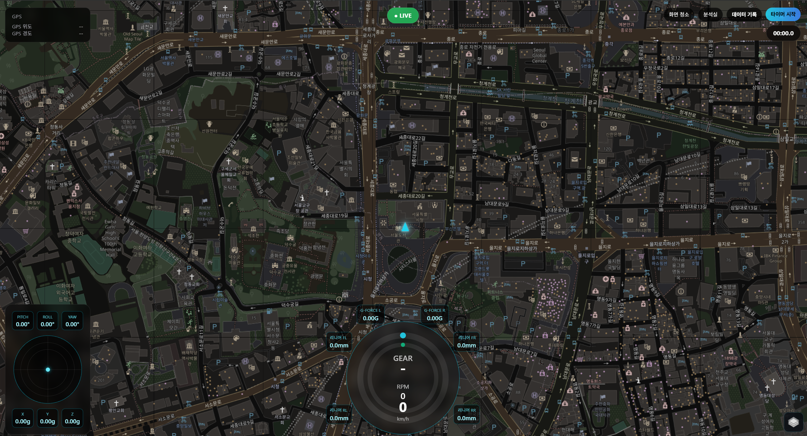
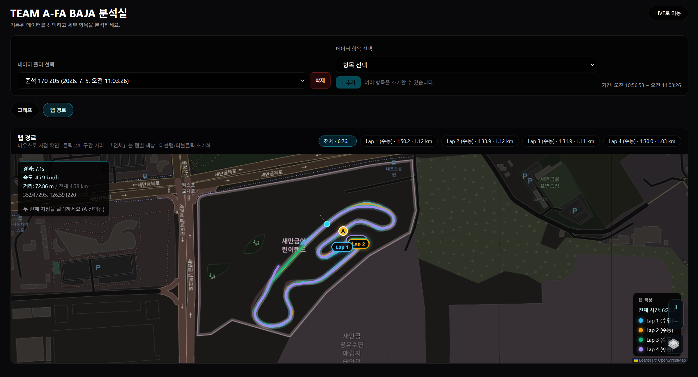
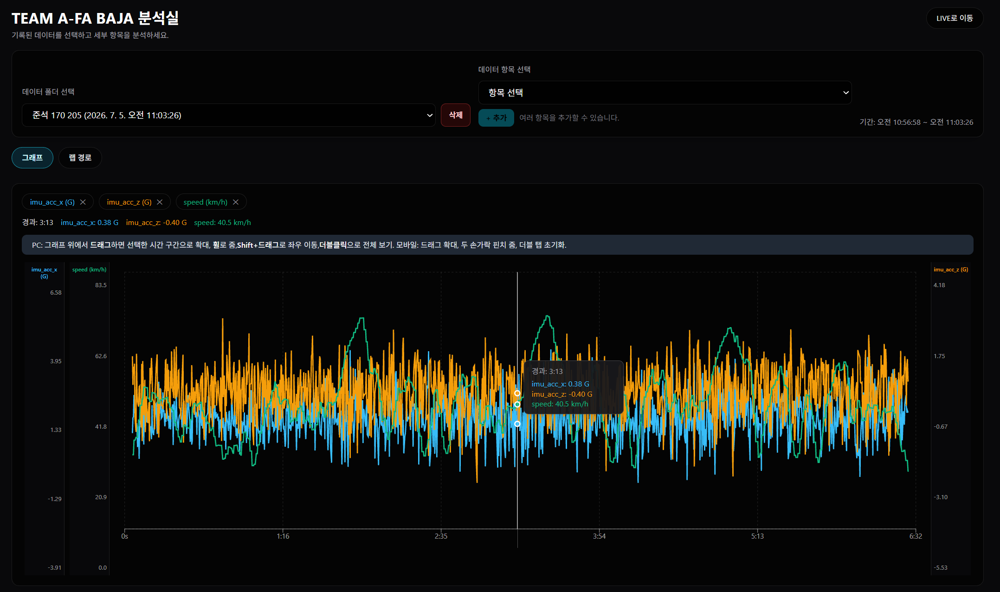

# 🖥️ Server — 실시간 텔레메트리 서버 & 웹 대시보드

차량 라즈베리파이가 MQTT로 보낸 센서·GPS 데이터를 **수집 → 정규화 → 저장 → 실시간 시각화 → 주행 후 분석**까지 처리하는 풀스택 텔레메트리 플랫폼입니다.
이 서버는 [서스펜션 최적화](../docs/suspension-analysis.md)의 실차 점프 시험에서 세팅별 피치 거동을 비교하는 데 실제로 쓰였습니다.

[← 메인 README로](../README.md) · [하드웨어 & MCU →](../hardware/README.md)

### LIVE 대시보드


### 분석실: 랩 경로


### 분석실: 다중 센서 그래프


---

## ✨ 주요 기능

### 🔴 LIVE 대시보드 (`/`)
- **실시간 HUD**: 속도·RPM·기어 게이지, IMU 자세(Pitch/Roll/Yaw)와 가속도(G), 좌우 G-Force, 서스펜션 리니어 센서 4륜 변위
- **실시간 지도**: Leaflet 지도(다크/위성 전환) 위에 차량 위치, 진행 방향, 속도 표시
- **자동 랩 추적**: GPS 궤적이 시작점으로 돌아오면 랩을 자동으로 판정하고, 랩별 경로를 색상으로 구분해 표시. 수동 랩 완료 기능도 지원
- **랩 타이머 & 기록 제어**: 주행 기록 시작·종료, 기록 이름 지정
- **접근 제어**: 비밀번호 잠금 화면
- **시험 중 안전 판단**: 탑아웃·바텀아웃, 과도한 롤, 큰 수직 충격이 반복되면 주행을 중단하고 압력을 바로 바꿀 수 있어 차량 손상을 막고 반복 시험 효율을 높였습니다.

### 📊 분석실 (`/analysis`)
- 저장된 주행 기록을 선택해 **여러 센서 항목을 한 차트에 겹쳐 비교** (다중 Y축, 드래그 확대·이동)
- **랩 트랙 뷰**: 랩별 주행 경로·랩타임·거리를 지도에서 확인하고, 두 지점을 찍어 구간 거리와 속도 측정
- GPS 노이즈로 생기는 비정상 속도값을 걸러내고, 빈 구간은 보간해 속도 프로파일 복원
- 기록 삭제·관리

| 분석 목적 | 비교 데이터 |
|---|---|
| 온로드 코너링 시 롤 억제 성능 | 속도, 롤 각도, 좌·우 리니어 변위 |
| 오프로드 언덕 통과 시 충격 흡수 | 속도, 피치, 프론트 Z축 가속도, 전륜 변위 |
| 바텀아웃 / 탑아웃 판단 | 쇼바 최대 압축·신장 변위, 프론트 Z축 가속도 |
| 감쇠 특성 비교 | 시간에 따른 쇼바 복귀 변위 |
| 압력 세팅별 성능 비교 | 같은 시험 구간의 롤·피치·변위·충격값 |

### ⚙️ 백엔드
- MQTT 토픽(`race/#`, `race/gps` 등) 구독 후 **센서 데이터 정규화** (단위, 위치, 타입 메타데이터 매핑)
- 시퀀스 번호·타임스탬프 기반으로 **순서가 뒤바뀐 패킷과 중복 패킷 제거**. 라즈베리파이가 재부팅돼 순번이 초기화돼도 측정 시각이 최신이면 새 데이터로 받아들입니다.
- **InfluxDB 비동기 저장**: 저장 경로와 실시간 전송 경로를 분리해 DB가 느려져도 실시간 화면이 밀리지 않도록 설계
- **WebSocket 브로드캐스트**: 큐 크기 제한, 전송 타임아웃, 좀비 연결 정리로 장시간 운영에도 안정적으로 동작
- 스트리밍 방식의 주행 기록 저장(JSONL + InfluxDB)과 분석용 쿼리 API

---

## 🏗️ 서버 아키텍처

```
 Raspberry Pi (차량) ── MQTT publish ──┐
                                       ▼
 ┌──────────────────────── 서버 (AWS EC2) ────────────────────────┐
 │   Mosquitto (MQTT Broker)                                      │
 │        │ subscribe race/#                                      │
 │        ▼                                                       │
 │   FastAPI 백엔드 ── 정규화 · 중복/역순 제거                      │
 │     │                          │                               │
 │     │ 비동기 큐                 │ 브로드캐스트 큐                 │
 │     ▼                          ▼                               │
 │   InfluxDB (시계열 DB)       WebSocket  ───────────────┐        │
 │     ▲                                                 │        │
 │     └──── REST API (기록·분석 조회) ◄──────────┐        │        │
 └───────────────────────────────────────────────┼────────┼────────┘
                                                 │        ▼
                                        ┌────────┴──────────────┐
                                        │ React 웹 대시보드      │
                                        │ LIVE HUD · 지도 · 분석 │
                                        └───────────────────────┘
```

---

## 🛠️ 기술 스택

| 영역 | 기술 |
|---|---|
| **Frontend** | React 18, Vite, Tailwind CSS, React Router, Leaflet, Recharts |
| **Backend** | Python, FastAPI, Uvicorn, Pydantic, paho-mqtt, asyncio |
| **Data** | InfluxDB 2 (시계열 DB), JSONL 기록 로그 |
| **Messaging** | Mosquitto (MQTT), WebSocket |
| **Infra** | AWS EC2 (Ubuntu), systemd |

---

## 📁 구조

```
server/
├── app/
│   ├── backend/                 # FastAPI 서버
│   │   ├── app.py               # 앱 진입점, REST/WS 라우트
│   │   ├── mqtt.py              # MQTT 구독, 센서 데이터 정규화
│   │   ├── telemetry.py         # 텔레메트리 공통 데이터 모델
│   │   ├── influx.py            # InfluxDB 비동기 쓰기 큐
│   │   ├── ws.py                # WebSocket 연결 관리, 브로드캐스트
│   │   ├── recordings.py        # 주행 기록 저장, 분석 쿼리, 랩 트랙
│   │   ├── api_models.py        # 요청/응답 스키마 (Pydantic)
│   │   ├── config.py            # 환경 설정
│   │   └── tools/               # 테스트용 가상 센서·GPS 퍼블리셔
│   └── frontend/                # React 대시보드
│       └── src/
│           ├── pages/           # LivePage, AnalysisPage
│           ├── components/      # SpeedGauge, AccelWidget, LapTrackView ...
│           ├── hooks/           # useWebSocket, useMap, useLapTracking
│           └── utils/           # 랩 판정, 속도 보정, 지도 테마
├── mosquitto/config/            # MQTT 브로커 설정
└── deploy/                      # systemd 서비스 정의
```

---

## 🔌 데이터 형식 (MQTT)

GPS 전용 토픽 예시: `race/gps`

```json
{
  "lat": 35.96962,
  "lon": 126.56772,
  "speed_kmh": 42.5,
  "course_deg": 180.0,
  "sats": 9,
  "hdop": 1.0
}
```

센서 데이터는 `race/sensor/<name>` 토픽으로 수신합니다. 패킷에는 장치 식별자, 순번(`seq`), 생성 시각(`ts_ms`), 측정 항목과 단위가 들어갑니다. 차량 쪽 송신 형식은 [`hardware/raspberry-pi/MQTT-GPS-GUIDE.md`](../hardware/raspberry-pi/MQTT-GPS-GUIDE.md)에 정리되어 있습니다.

---

## 🚀 실행 방법

아래 명령은 모두 `server/` 디렉터리 기준입니다.

### 1. 사전 준비
- Python 3.10+, Node.js 18+
- Mosquitto, InfluxDB 2

### 2. 설정 파일
```bash
cp app/backend/.env.example app/backend/.env
```

```bash
cp app/frontend/.env.example app/frontend/.env
```

### 3. 백엔드
```bash
cd app/backend
python3 -m venv venv && source venv/bin/activate
pip install -r requirements.txt
uvicorn app:app --host 0.0.0.0 --port 8000
```

### 4. 프론트엔드
```bash
cd app/frontend
npm install
npm run dev        # http://localhost:5173
```

### 5. 하드웨어 없이 테스트
```bash
# 가상 GPS: 약 450m 폐루프를 10km/h로 주행
python app/backend/tools/saemangeum_loop_gps.py
```

```bash
# 가상 센서 데이터
python app/backend/tools/random_sensor_publisher.py
```

### 6. 배포 (systemd)
`deploy/*.service`는 `server/` 디렉터리 내용을 EC2의 `/opt/race-stack`에 둔다고 가정합니다 (`/opt/race-stack/app/backend`).

---

## 📡 주요 API

| Method | Endpoint | 설명 |
|---|---|---|
| `GET` | `/health` | InfluxDB·MQTT 연결 및 내부 큐 상태 |
| `WS` | `/ws` | 실시간 텔레메트리 스트림 |
| `POST` | `/api/recordings/stream/start` · `append` · `stop` | 스트리밍 주행 기록 |
| `GET` | `/api/recordings` | 기록 목록 |
| `GET` | `/api/analysis/fields` | 기록별 분석 가능 항목 |
| `POST` | `/api/analysis/query` | 분석용 시계열 조회 |
| `GET` / `PUT` | `/api/analysis/track`, `/api/recordings/{id}/track` | 랩 트랙 조회·저장 |
| `GET` | `/api/sensors/latest` | 센서별 최신값 |

FastAPI 자동 문서: `http://<서버>:8000/docs`

---

## 🧩 기술적 고민과 해결

- **실시간성과 저장 안정성 분리**: 처음에는 DB 쓰기와 WebSocket 전송이 같은 경로에 있어서 InfluxDB가 지연되면 화면도 함께 멈췄습니다. 저장 큐와 브로드캐스트 큐를 분리하고 큐 크기를 제한해 한쪽 지연이 다른 쪽에 번지지 않게 했습니다.
- **좀비 WebSocket 연결**: 클라이언트가 비정상적으로 끊기면 send 호출이 바로 실패하지 않고 대기하면서 전체 브로드캐스트가 멈추는 문제가 있었습니다. 전송 타임아웃을 두고 응답 없는 연결을 정리하도록 바꿨습니다.
- **GPS 노이즈 보정**: GPS가 튀면 순간 속도가 비현실적으로 크게 계산됩니다. 랩 평균 속도를 기준으로 이상값을 걸러내고 빈 구간은 보간해 속도 프로파일을 복원했습니다.
- **필요한 구간만 기록**: 모든 데이터를 상시 저장하면 분석이 느려져서, 웹에서 기록 시작~종료 버튼을 누른 구간만 시계열 DB와 원본 로그(JSONL)에 동시에 저장하도록 했습니다.
- **기능 범위 조정**: 초기에는 LiveKit(WebRTC)과 coturn으로 차량 카메라 영상을 실시간 송출하는 기능까지 구현했습니다. 이후 카메라가 고장 나 영상 기능을 제거하고, 메모리 2GB인 서버 자원을 텔레메트리 수집과 시각화에 집중하도록 구조를 정리했습니다.
